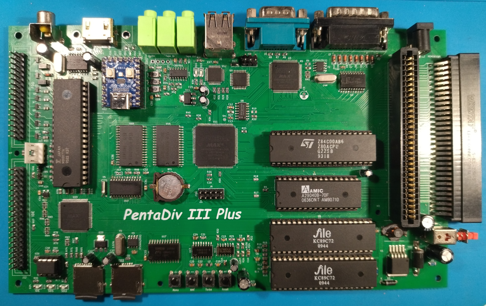
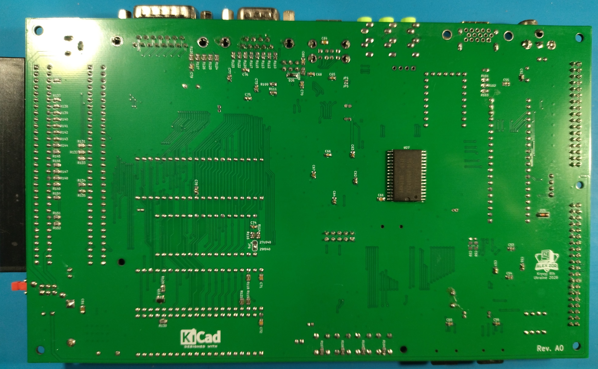
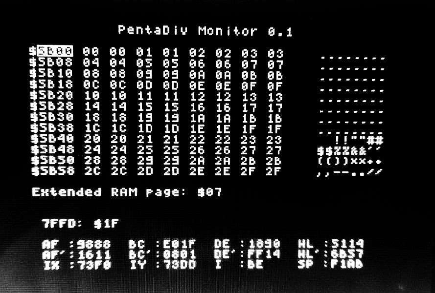
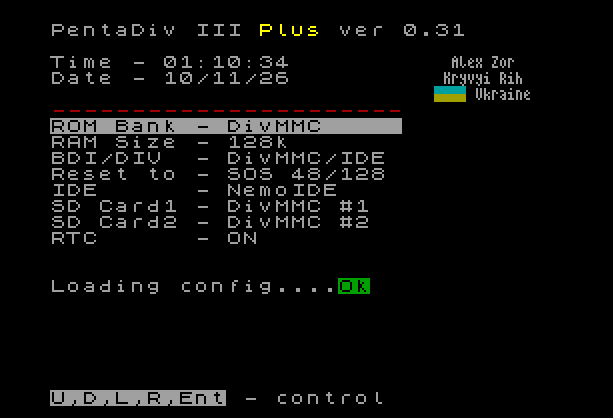
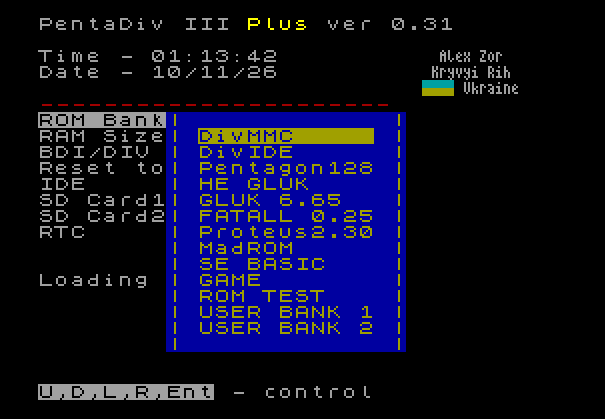

# PentaDiv3 Plus

**PentaDiv3 Plus** is an advanced ZX Spectrum clone with Pentagon 128 timings, featuring extended memory, enhanced audio, flexible storage options, and a rich set of built-in peripherals — all in one board.

---

## Board Photos

<p align="center">
  
  <br/><em>PCB — Top Side</em>
</p>

<p align="center">
  
  <br/><em>PCB — Bottom Side</em>
</p>

---

## Overview

PentaDiv3 Plus is a feature-rich single-board ZX Spectrum compatible computer. It is based on the classic Pentagon 128 architecture and extends it with modern storage, enhanced audio, expanded memory, and convenient configuration tools — while remaining fully compatible with the original ZX Spectrum software ecosystem.

---

## Key Specifications

### CPU & Memory
| Parameter | Value |
|-----------|-------|
| CPU | Z80 (compatible) |
| Timings | Pentagon 128 |
| RAM | **1.5 MB** |
| ROM | **512 KB** (32 banks × 16 KB) |
| SPI Flash | Onboard — extended ROM storage |
| Turbo modes | 7 MHz / 14 MHz / ×4 acceleration (all in NoWait mode) |

### Audio
| Feature | Details |
|---------|---------|
| TurboSound | Dual AY-3-8912 / YM2149 (AY/YM) |
| FM Synthesis | OPL3 — Yamaha YMF262 |

### Video Output
- **CVBS** (composite)
- **HDMI**
- **VGA**

### Storage
| Interface | Details |
|-----------|---------|
| DivMMC | Built-in — microSD card slot (ESXDOS / Z-Controller compatible) |
| DivIDE | True IDE interface for real IDE HDD |

### Connectivity & Peripherals
| Connector | Description |
|-----------|-------------|
| USB Type-A ×2 | USB Keyboard + USB Mouse |
| Joystick | Sega (Mega Drive) + Dendy (NES) compatible |
| Mechanical keyboard | Dedicated connector for a matrix keyboard |
| NemoBUS ×2 | Standard expansion slots |
| Audio Out | Analog stereo audio output |
| Tape Out | Cassette recorder output (EAR) |
| Tape In | Cassette recorder input (MIC) |
| Power input | DC 12 V |

### Real-Time Clock
- **RTC** compatible with the Mr. Gluck standard

### FDD (Floppy Disk Drive)
- Built-in **BDI** (Beta Disk Interface) for FDD operation

---

## NMI Buttons

The board has **two dedicated NMI buttons**:

| Button | Function |
|--------|----------|
| **NMI 1** | Invokes **Magic** handler or **NMI Browser** (esxdos) |
| **NMI 2** | Invokes the **built-in Monitor** |

### Built-in Monitor

<p align="center">
  
  <br/><em>Built-in Monitor (invoked by NMI 2)</em>
</p>

---

## Configuration Menu

A built-in settings menu is available at power-on or by **holding the Reset button for 2 seconds**.

<p align="center">
  
  <br/><em>Main settings menu</em>
</p>

### Available Settings

| Setting | Options / Notes |
|---------|-----------------|
| **ROM Bank** | Select from 32 ROM banks (see ROM map below) |
| **RAM Size** | 128 KB / 512 KB / 1024 KB |
| **Reset to** | Service ROM or SOS |
| **SD Standard** | DivMMC / Z-Controller |
| **RTC** | Enable / Disable |
| **Port FF** | Enable / Disable |
| **OPL3** | Enable / Disable |
| **Joystick Type** | Kempston / Sega / Dendy / … |
| **Swap FDD** | Swap drive A: ↔ B: |

> All settings are stored in **non-volatile memory** (EEPROM).

<p align="center">
  
  <br/><em>ROM Bank selection screen</em>
</p>

---

## ROM Map (firmware v0.3)

| Bank | Offset | Contents |
|------|--------|----------|
| 0 | 0x00000 | PentaDiv Menu |
| 1 | 0x04000 | SOS 48 |
| 2 | 0x08000 | SOS 128 |
| 3 | 0x0C000 | SOS Pentagon |
| 4 | 0x10000 | HE Gluk 0.19 |
| 5 | 0x14000 | Gluk 6.63 |
| 6 | 0x18000 | SOS with Fatall |
| 7 | 0x1C000 | Fatall |
| 8 | 0x20000 | SOS with Proteus |
| 9 | 0x24000 | Proteus 2.3 |
| 10 | 0x28000 | TR-DOS Proteus |
| 11 | 0x2C000 | TR-DOS 5.04TM |
| 12 | 0x30000 | TR-DOS 6.11Q |
| 13 | 0x34000 | ESXDOS MMC |
| 14 | 0x38000 | MADROM |
| 15 | 0x3C000 | Empty |
| 16 | 0x40000 | Game |
| 17 | 0x44000 | SE Basic |
| 18 | 0x48000 | RomTest 1.02 bank0 |
| 19 | 0x4C000 | RomTest 1.02 bank1 |
| 20 | 0x50000 | RomTest 1.02 bank2 |
| 21 | 0x54000 | RomTest 1.02 bank3 |
| 22 | 0x58000 | ESXDOS IDE |
| 23 | 0x5C000 | PentaDiv Monitor |
| 24 | 0x60000 | User Bank 1 — Service ROM / ESXDOS |
| 25 | 0x64000 | User Bank 1 — TR-DOS |
| 26 | 0x68000 | User Bank 1 — SOS 128 |
| 27 | 0x6C000 | User Bank 1 — SOS 48 |
| 28 | 0x70000 | User Bank 2 — Service ROM / ESXDOS |
| 29 | 0x74000 | User Bank 2 — TR-DOS |
| 30 | 0x78000 | User Bank 2 — SOS 128 |
| 31 | 0x7C000 | User Bank 2 — SOS 48 |

---

## Repository Structure

```
PentaDiv3Plus/
├── A1/
│   ├── Schematic/
│   │   ├── PentaDiv3Plus_A1.pdf   — Full schematic (PDF)
│   │   └── bom/
│   │       └── ibom.html          — Interactive BOM (open in browser)
│   ├── gerbers/                   — Gerber files for PCB manufacturing
│   └── firmware0.3/
│       ├── ROM/
│       │   ├── 0.3.BIN            — ROM image (512 KB)
│       │   ├── ROMmap.txt         — ROM bank map
│       │   └── changelog.txt      — ROM changelog
│       ├── CPLD/
│       │   ├── main.pof           — Main CPLD bitstream
│       │   ├── IO_1.pof           — I/O CPLD 1 bitstream
│       │   ├── IO_2.pof           — I/O CPLD 2 bitstream
│       │   ├── CPLD Programming.png
│       │   └── ReadMe.txt         — CPLD firmware changelog
│       └── Atmega8/
│           ├── HID_0.1.hex        — USB HID controller firmware
│           ├── Fuses.png          — ATmega8 fuse settings
│           └── Readme.txt
├── top.jpg                        — PCB photo (top)
├── bottom.jpg                     — PCB photo (bottom)
├── menu1.png                      — Settings menu screenshot
├── menu2.png                      — ROM bank selection screenshot
├── monitor.jpg                    — Built-in monitor screenshot
└── README.md
```

---

## Firmware

### ROM (v0.3)
- 512 KB ROM image with 32 selectable banks
- Includes PentaDiv Menu, multiple SOS variants, TR-DOS, ESXDOS, diagnostics, and user banks
- **Changelog:**
  - v0.1p — First release
  - v0.2p — Fixed ESXDOS RAM clearing; added DivMMC 1024k mode
  - v0.3 alpha — Added DivIDE; added Monitor 0.1; added SPI Flash loader

### CPLD (v0.3)
Three CPLDs handle main logic, and two I/O expansion CPLDs:
- **Changelog:**
  - v0.1 — First release
  - v0.2 — Fixed opening ROM files in ESXDOS
  - v0.3 — Added DivIDE; changed ROM logic
  - FIX 1 — NemoIDE fix
  - FIX 2 — CSROMGE did not block virtual ROM

### ATmega8 HID Controller (v0.1)
- Handles USB keyboard and USB mouse
- First release

> ⚠️ **Note:** Firmware source code will be added in a future release.

---

## PCB Manufacturing

Gerber files are located in `A1/gerbers/`. The board is a standard 2-layer PCB produced in KiCad.

Recommended PCB parameters:
- Layers: 2
- Copper weight: 1 oz
- Surface finish: HASL or ENIG
- Board color: your preference

The interactive BOM (`A1/Schematic/bom/ibom.html`) can be opened in any browser for component placement assistance.

---

## Programming the CPLD

Refer to `A1/firmware0.3/CPLD/CPLD Programming.png` for the JTAG wiring diagram.

Three `.pof` files must be programmed:
- `main.pof` — Main CPLD
- `IO_1.pof` — I/O CPLD 1
- `IO_2.pof` — I/O CPLD 2

Use **Altera Quartus Programmer** (or compatible tool) with a USB-Blaster interface.

---

## Programming the ATmega8

Refer to `A1/firmware0.3/Atmega8/Fuses.png` for the correct fuse settings before flashing.

Flash `HID_0.1.hex` using **avrdude** or any compatible AVR programmer:

```bash
avrdude -c usbasp -p m8 -U flash:w:HID_0.1.hex:i
```

---

## License

Hardware design files (schematics, gerbers, BOM) are released under the **CERN Open Hardware Licence v2 — Weakly Reciprocal (CERN-OHL-W v2)**.

Firmware binaries are provided as-is for use with PentaDiv3 Plus hardware. Source code will be published separately.

---

## Acknowledgements

- ZX Spectrum original design — **Sinclair Research**
- Pentagon 128 architecture — **ZX Revue / Pentagon development group**
- ESXDOS — the esxdos development team
- Mr. Gluck RTC standard — the ZX Spectrum community
- TurboSound concept — the ZX Spectrum demoscene community

---

*PentaDiv3 Plus — bringing the best of the ZX Spectrum universe onto a single modern board.*
